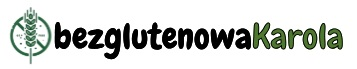

<div align="center">
  <h1>Bezglutenowa Karola</h1>
  
  <p><em>A recipe, advice, and recommendation website for people with celiac disease and gluten-free diets.</em></p>
</div>

<div align="center">
  <a href="https://bezglutenowakarola.pl">🌐 Live site</a> •
  <a href="#features">Features</a> •
  <a href="#local-setup">Local setup</a> •
  <a href="#project-structure">Project structure</a>
</div>

---

## About the project

This is a modern website dedicated to healthy, gluten-free, sugar-free, and dairy-free eating. Its main goal is to provide culinary inspiration, information about gluten-free diets, location recommendations, and practical tools for people with celiac disease and those following elimination diets.

The site is built with Next.js using React, TypeScript, and Sass. It includes informational content and interactive features such as recipe search, a gluten-free places map, a product discovery page, and educational sections.

## Features

### 1. Recipe database and recipe search

- dedicated pages for breakfasts, dinners, snacks, and desserts,
- recipe categories and product-focused discovery,
- search/filter experience for gluten-free recipes,
- clearly organized recipe cards and detailed individual recipe pages.

### 2. Meal planner and weekly organization

- weekly gluten-free meal planning,
- practical organization of dishes across the week,
- a helpfully structured planning flow for everyday eating.

### 3. Product catalog and shopping discovery

- searchable catalog of gluten-free products,
- filters by product name and store or brand,
- product cards with basic metadata and external source links,
- convenient browsing for grocery shopping and product comparisons.

### 4. Map of gluten-free places

- interactive map with location markers,
- search by name, address, city, and country,
- list view with pagination and location jumping,
- recommendations for restaurants, bakeries, cafés, and other places in Poland and Europe.

### 5. Educational content and community resources

- articles about celiac disease and gluten-free living,
- practical advice for everyday life after diagnosis,
- events, workshops, and collaboration opportunities,
- inspiration for eating, traveling, and staying well informed.

### 6. Games and entertainment hub

- dedicated games page at `/gry`,
- lightweight browser games designed for short breaks,
- local score tracking in the browser,
- playful educational and reaction-based experiences around gluten-free living.

### 7. Responsive, modern UI

- mobile-friendly and desktop-friendly layout,
- reusable components and consistent styling,
- SCSS-based design system,
- integration of sliders, icons, and visual content.

## Games available

The site includes a full mini-game section with five games accessible from `/gry`:

- `Łap bezglutenowe produkty` (`/gra-lapacz`) – a timed reaction-catching game where you collect safe gluten-free items and avoid gluten-containing ones.
- `Snake` (`/gra-snake`) – the classic Snake experience with increasing difficulty and score chasing.
- `Bezglutenowy quiz` (`/gra-quiz`) – a knowledge game focused on gluten-free products, ingredients, and healthy choices.
- `Wyścig` (`/gra-wyscig`) – a fast-paced racing challenge built for score-focused play.
- `Karola i bezglutenowa kraina` (`/gra-karola`) – a platformer adventure with jumping, collecting rewards, and progressing through levels.

Each game includes a different gameplay style and is designed to make the gluten-free lifestyle more engaging and fun.

## Tech stack

- Next.js 16
- React 19 RC
- TypeScript
- Sass / SCSS
- Leaflet + react-leaflet
- Swiper
- react-icons
- sharp

## Local setup

### Requirements

- Node.js 18+ (recommended 18.18+ or newer)
- npm / yarn / pnpm / bun

### Installation

```bash
git clone https://github.com/goldipl/foods-website.git
cd foods-website
npm install
```

### Development mode

```bash
npm run dev
```

Once started, the app is available at:

```text
http://localhost:3000
```

### Production build

```bash
npm run build
```

### Production server

```bash
npm run start
```

### Additional scripts

```bash
npm run lint
npm run export
```

## Project structure

```text
foods-website/
├── public/                       # static assets: images, icons, graphics
│   ├── icons/
│   ├── img/
│   └── ...
├── screenshots/                  # project screenshots
├── src/
│   ├── app/                      # Next.js app configuration
│   ├── components/
│   │   ├── common/               # shared components (header, footer, modal, searchbar)
│   │   ├── games/                # interactive mini-games: catcher, Snake, quiz, race, platformer
│   │   ├── main-page/            # landing page sections
│   │   ├── map/                 # map component and geolocation logic
│   │   ├── recipes/             # recipe lists and search
│   ├── css/                      # external CSS libraries
│   ├── data/                     # recipe, events, hotels, restaurant, and map data
│   ├── fonts/                    # custom fonts
│   ├── pages/                    # application pages (routing)
│   ├── sass/                     # SCSS project styles
│   └── utils/                    # constants and helpers
├── package.json                  # dependencies and scripts
├── tsconfig.json                 # TypeScript configuration
├── next.config.mjs               # Next.js configuration
├── README.md                     # project documentation
├── LICENSE.md                    # project license
└── .gitignore                    # files ignored by Git
```

## Main pages

- `/` — homepage with informational sections and promotions
- `/szukaj-przepisow` — recipe search and all-recipe list
- `/planer-posilkow` — weekly gluten-free meal planner
- `/produkty` — searchable product catalog with filters and external source links
- `/sniadania` — breakfast recipes
- `/obiady` — dinner recipes
- `/przekaski` — snack recipes
- `/desery` — gluten-free desserts
- `/restauracje-w-polsce` — restaurants in Poland
- `/restauracje-w-europie` — restaurants in Europe
- `/hotele` — hotel recommendations
- `/wydarzenia` — events calendar
- `/bezglutenowe-miejsca` — interactive map of locations
- `/artykuly` — article list
- `/gry` — games hub with all available mini-games
- `/gra-lapacz` — timed gluten-free catcher game
- `/gra-snake` — classic Snake game
- `/gra-quiz` — gluten-free knowledge quiz
- `/gra-wyscig` — racing game
- `/gra-karola` — platformer adventure

## Deployment

The project is prepared for deployment on platforms supporting Next.js, primarily:

- Vercel
- Netlify
- other hosts supporting Node.js and Next.js

## Contributing

Contributions and improvements are welcome.

1. Fork the repository.
2. Create a feature branch.
3. Make your changes and check them locally.
4. Open a pull request with a description of the changes.

Note that the project currently does not include automated unit tests; the key verification step is local build and linting.

## License

This project is distributed under the following license:

Creative Commons Attribution-NonCommercial 4.0 International (CC BY-NC 4.0)

[](https://creativecommons.org/licenses/by-nc/4.0/)

## Contact

- Website: [bezglutenowakarola.pl](https://bezglutenowakarola.pl)
- GitHub: [goldipl/foods-website](https://github.com/goldipl/foods-website)
- Project author: Karolina Wontorska-Godlewska
- Technical support / maintenance: Marcin Godlewski

---

<div align="center">
  <p>Made with ❤️ for the gluten-free community.</p>
</div>
